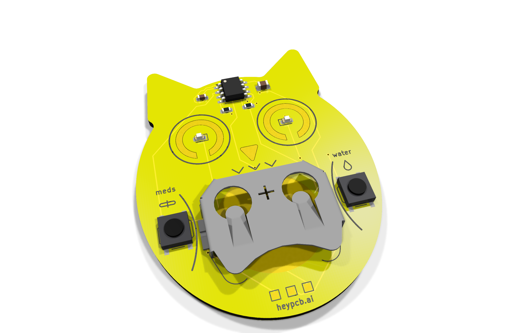
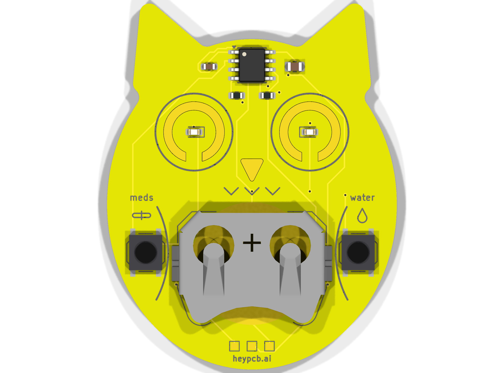
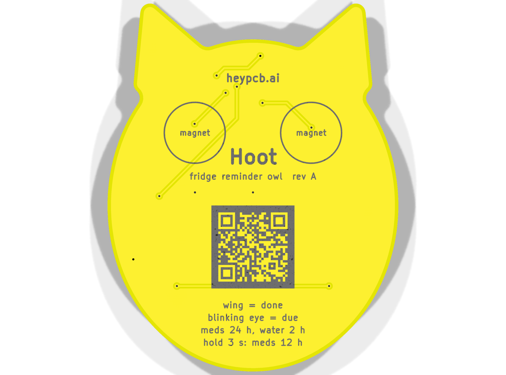

# Hoot, the fridge reminder owl

**The fridge owl that blinks at you until you've taken your meds and had your water.**

Hoot is a yellow owl-shaped fridge magnet with two reminders. Its left wing is a button marked "meds", its right wing "water". Press a wing when you have done the thing: that eye glows and its timer restarts. When the reminder comes due again (meds every 24 h or 12 h, water every 2 h), that orange LED eye blinks until you press. An ATtiny412 sleeps in power-down between one-second RTC ticks, so a CR2032 lasts about 14 months of typical use. Gold ENIG eye rings and beak on yellow mask; magnets go on the flat back.

| Layers | Size | Parts | Nets | Connections routed | Vias | ERC errors | DRC errors / unconnected / parity | BOM @100 |
|---|---|---|---|---|---|---|---|---|
| 2 | 42.1 x 53.3 mm | 10 (+3 pads) | 9 | 24 -> 0 open | 13 | 0 | 0 / 0 / 0 | $1.09 |

**Not fabricated, assembled or powered yet.** Every number on this page is measured by KiCad 10.0.6 on
the files in this repository ([`report.json`](report.json), [`measured.json`](measured.json)) or read
from the live JLC/LCSC catalogue ([`bom_cost.json`](bom_cost.json)).

| | |
|---|---|
| Spec, power budget, BOM | [`SPEC.md`](SPEC.md) |
| Store copy | [`STORE_COPY.md`](STORE_COPY.md) |
| KiCad 10 project | [`kicad/`](kicad/) |
| Gerbers, drill, BOM, CPL, STEP, schematic PDF | [`fab/`](fab/) |
| Firmware | [`firmware/`](firmware/) |
| Renders | [front](media/top.png), [back](media/bottom.png), [hero](media/hero.png), [Circuit World thumbnail](media/circuit-world.png) |
| Brief and generator | [`design/`](design/) |

 

## What's on it

- **Reminders:** meds (left wing, left eye) every 24 h, or 12 h by holding the wing 3 s; water (right wing, right eye) every 2 h.
- **Due:** that eye flashes every 2 s; after an hour unanswered it dozes to one flash every 10 s until a wing is pressed.
- **MCU:** ATtiny412 in power-down, woken once a second by the RTC and at once by a wing (PA2/PA6, the fully asynchronous pins); UPDI pads on the chin.
- **Power:** one CR2032 in a Keystone 3034 holder; about 17.5 µA on a typical day (see SPEC.md).
- **Mounting:** two 8 x 2 mm disc magnets on the rings printed on the back.

## Finish

Yellow solder mask, Black silkscreen, ENIG copper finish, 1.6 mm FR4, top-side SMT assembly.
The gold art is bare copper under a mask opening (ENIG), drawn with its own keep-out so no track runs
under it. The QR code on the back opens [https://heypcb.ai/world/b/01a4dcf69333](https://heypcb.ai/world/b/01a4dcf69333).

## How it was made

Designed with the HeyPCB method on KiCad 10.0.6, headless, by the `heypcb-kicad` pipeline: a written
brief composed from reusable circuit blocks, every pin from KiCad's own symbol library, every part bound
to an LCSC number from a dated catalogue read, then ERC, a netlist round trip, locked placement,
Freerouting 2.4.1, pours, silkscreen and board art, DRC with schematic parity, DFM and a fab gate,
each stage gated by a measurement. `design/make_brief.py` regenerates the brief (outline, part
locks and art) from code.

Part of the [heypcb.ai merch collection](https://github.com/HeyPCB/merch).

## License

Hardware: [CERN-OHL-S v2](LICENSE). Firmware: MIT (see [`firmware/LICENSE`](firmware/LICENSE)). KiCad's symbol, footprint and 3D
libraries used in the design are CC-BY-SA 4.0 with the KiCad library exception.
